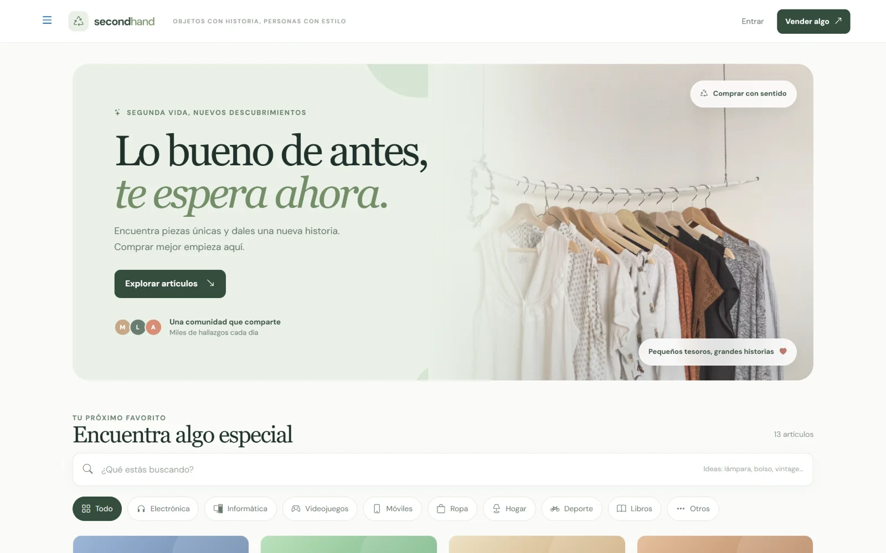
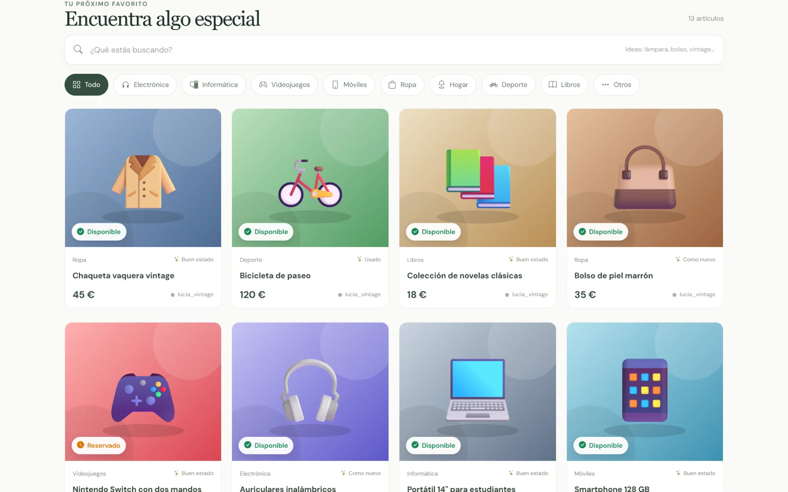
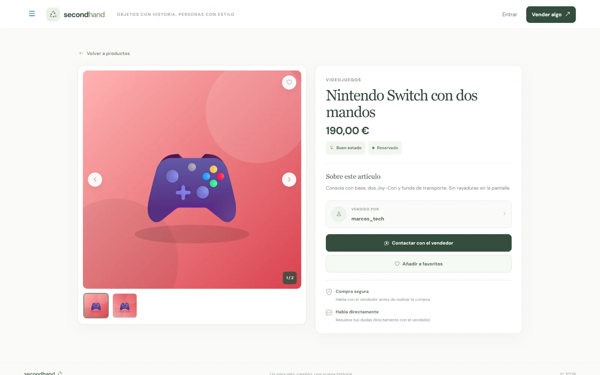
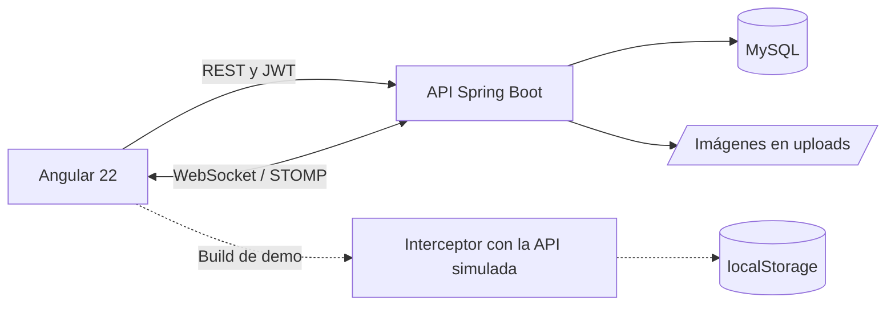

# SecondHand

Compraventa de productos de segunda mano: publica artículos con fotos, encuentra lo que buscas con filtros, habla con quien vende por chat y cierra la compra con ofertas, reservas y pago.

**[Ver la demo](https://vanerb.github.io/secondhand-angular-java/)**: funciona en el navegador, sin instalar nada.

**Stack:** Angular 22 · Angular Material · Spring Boot 4.1 · Java 21 · Spring Security y JWT · WebSocket (STOMP) · MySQL

## Qué puedes hacer

- **Productos:** publicar, editar y borrar artículos con varias fotos, categoría, precio, estado de conservación y disponibilidad.
- **Búsqueda:** por nombre o descripción, con filtros de categoría, precio, estado y disponibilidad.
- **Favoritos:** guardar productos para volver a ellos.
- **Chat:** conversaciones en tiempo real entre comprador y vendedor, cada una ligada a un producto.
- **Compra:** ofertas de precio que se aceptan o rechazan, reserva del producto y pago con tarjeta simulado o en efectivo.
- **Cuenta:** registro, inicio de sesión y perfil con foto.

Ver los productos es público; para comprar, vender o chatear hace falta iniciar sesión.

| Categorías | Estados | Disponibilidad |
| --- | --- | --- |
| Electrónica, Informática, Videojuegos, Móviles, Ropa, Hogar, Deporte, Libros y Otros | Nuevo, Como nuevo, Buen estado, Usado y Muy usado | Disponible, Reservado y Vendido |

### Capturas

| Inicio | Catálogo |
| --- | --- |
|  |  |

**Ficha de un producto**



<p align="center">
  
</p>

## Demo

La demo es el frontend compilado en modo `demo`: un interceptor HTTP simula toda la API dentro del navegador, con las mismas rutas, validaciones y errores, y el chat por WebSocket se sustituye por uno local. Tus cambios se guardan en el `localStorage` de tu navegador y el botón **Restablecer datos** del aviso inferior vuelve al estado inicial.

| Correo | Qué tiene preparado |
| --- | --- |
| `lucia@secondhand.demo` | Una oferta por responder y una compra pendiente de pago |
| `marcos@secondhand.demo` | Una venta reservada esperando el pago de Lucía |
| `ana@secondhand.demo` | Una compra pagada con tarjeta y una conversación abierta |

La contraseña de todas es `Demo1234`. Como no hay servidor, los mensajes no llegan a otros dispositivos: para ver la otra parte de una conversación, cierra sesión y entra con la otra cuenta.

## Cómo está construido



```text
backend/     API de Spring Boot: controladores, servicios, entidades y seguridad
frontend/    Web de Angular y build de demo
database/    Base de datos de prueba para MySQL
```

## Decisiones técnicas

- **El flujo de compra lo controla la API.** Oferta, reserva y pago cambian el estado del producto en el servidor, que comprueba en cada paso quién puede hacer qué.
- **Chat en tiempo real.** Los mensajes viajan por WebSocket con STOMP; cada conversación queda ligada al producto del que se habla.
- **Catálogo público, acciones protegidas.** Cualquiera puede ver el listado y la ficha de un producto; publicar, comprar, guardar favoritos o chatear exige un token JWT válido.
- **Configuración en un solo sitio.** La URL de la API y la del WebSocket están en `frontend/src/environments/environment.ts`, y la clave de las sesiones sale de la variable `JWT_SECRET`.

## Puesta en marcha

Necesitas Node.js 24 o superior, Java 21 (el proyecto trae Maven Wrapper, así que no hace falta instalar Maven) y MySQL 8.

**API**, en `http://localhost:8080`:

```bash
cd backend
./mvnw spring-boot:run
```

En Windows, usa `.\mvnw.cmd spring-boot:run`. Hibernate crea las tablas al arrancar, pero la base `secondhand_bd` tiene que existir (o importar los datos de prueba, que la crean).

**Web**, en `http://localhost:4200`, desde otra terminal:

```bash
cd frontend
npm install
npm start
```

Para abrir la demo en local, sin backend: `npx ng serve --configuration demo`.

### Configuración

| Variable | Por defecto | Uso |
| --- | --- | --- |
| `SPRING_DATASOURCE_URL` | `jdbc:mysql://localhost:3306/secondhand_bd` | Conexión con MySQL. |
| `SPRING_DATASOURCE_USERNAME`, `SPRING_DATASOURCE_PASSWORD` | `root`, vacío | Credenciales de MySQL. |
| `JWT_SECRET` | Clave de desarrollo | Firma de las sesiones. Si despliegas el proyecto, define una propia y larga. |
| `SERVER_PORT` | `8080` | Puerto de la API. |

Si cambias el puerto o la dirección de la API, cambia también `apiUrl` y `wsUrl` en [`frontend/src/environments/environment.ts`](frontend/src/environments/environment.ts).

### Datos de prueba

[`database/secondhand_prueba.sql`](database/secondhand_prueba.sql) crea la base `secondhand_bd` con usuarios, productos, favoritos, conversaciones, ofertas y un pago inventados. No borra nada: si las tablas ya existen, la importación se detiene con un error.

```bash
mysql -u root -p --default-character-set=utf8mb4 -e "source database/secondhand_prueba.sql"
```

Cuentas: `lucia@secondhand.test`, `marcos@secondhand.test`, `ana@secondhand.test` y `pablo@secondhand.test`. La contraseña de todas es `Usuario123*`. Es pública, así que no uses estas cuentas fuera de un entorno local.

## Tests

Todavía no tiene tests propios: solo las pruebas de creación que Angular genera para cada componente.

## Limitaciones conocidas

- La API no tiene tests automáticos.
- El pago con tarjeta es simulado: no se conecta con ninguna pasarela.
- Las imágenes se guardan en el disco del servidor, así que un despliegue real necesitaría almacenamiento persistente.
- Ideas pendientes: notificaciones, valoraciones entre usuarios y localización de productos.

## Autoría

Proyecto de portfolio de **Vanesa Ribera Bautista** ([vanerb](https://github.com/vanerb)).
